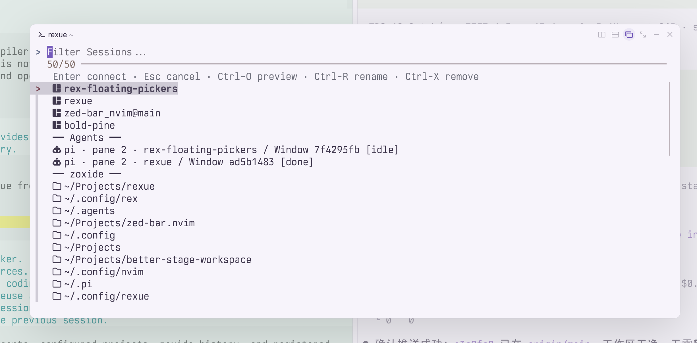
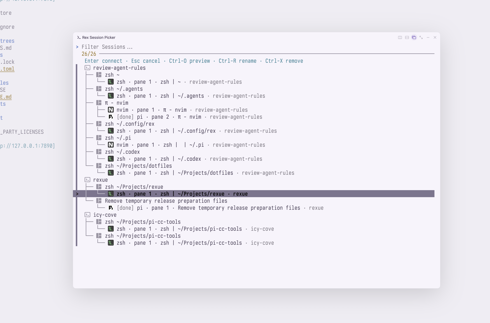

# rexue

An **fzf picker for Rex sessions, coding agents, and Git worktrees**. Connect to a project once; later visits reuse its session. Currently verified on macOS.

## Demo

Session and agent picker:



Worktree picker:



## Install

Install and open [Rex](https://www.superlogical.com/rex/docs/installation). Run the following commands inside a Rex terminal, where its `rex` CLI is already on `PATH`.

With [Homebrew](https://brew.sh), install Rust and fzf, then rexue:

```sh
brew install rust fzf
cargo install --locked rexue
```

Requires Rust **1.90+**, fzf **0.63+**, and a C compiler. If Apple's Command Line Tools are missing, run `xcode-select --install` first. If `rexue` is not found after installation, add `export PATH="$HOME/.cargo/bin:$PATH"` to `~/.zshrc` and open a new terminal.

Optional dependencies:

```sh
brew install git worktrunk # Worktrees; provides wt (0.81.0+ required).
brew install zoxide       # Directory history.
```

Follow [zoxide's shell setup](https://github.com/ajeetdsouza/zoxide#installation) to record directories as you navigate. To install rexue from a local checkout, use `cargo install --locked --path .`.

## Use

```sh
rexue                        # Open the picker.
rexue list                   # List all sources.
rexue list --agents          # List running coding agents.
rexue connect ~/Projects/app  # Create or reuse a project session.
rexue connect app            # Connect by session name or configured alias.
rexue last                   # Return to the previous session.
```

The picker combines Rex sessions, running agents, configured projects, zoxide history, and registered worktrees. Each live session shows its tab titles in brackets, such as `app [ Shell] [󰚩 Agents · Fix login]`. Nerd Font icons distinguish ordinary tabs (``) from tabs containing live agents (`󰚩`), including when only sessions are listed. A custom tab name takes priority; otherwise, Rexue uses the focused terminal's title, falling back to its pane label when no title is available. Ordinary tab titles display `|` separators as spaces, collapsing adjacent spaces. Tabs also include their live agents' terminal titles, with repeated titles shown once per tab. An unnamed agent tab without a title falls back to the agent app name. Disable icons with `picker --icons=false` or `[tui] show_icons = false`. Agent rows start with their session name, such as `app / pi · pane 1 · Agents [working]`. Selecting an agent focuses its terminal pane and tab.

**Enter** connects, **Esc** cancels, **Ctrl+J/K** moves, and **Ctrl+O** toggles preview. **Ctrl+R** renames a session; **Ctrl+X** asks to remove a live session, history entry, or worktree. Configure one or more keys per action in [`[tui.keybindings]`](docs/CONFIGURATION.md#keybindings); omitted actions keep these defaults.

For worktrees, run inside a Git repository or add `--path ~/Projects/app`:

```sh
rexue worktree picker
rexue worktree create feature/widgets
rexue worktree connect feature/widgets
rexue worktree remove feature/widgets --no-delete-branch
```

[Worktrunk](https://worktrunk.dev/config/) manages checkout paths, hooks, and removal rules. With multiple Rex apps connected, select one with `rexue --client my-mac`. Use `rexue --help` or `rexue <command> --help` for all options.

## Configure

Configuration is optional. Create `~/.config/rexue/rexue.toml`, or `$XDG_CONFIG_HOME/rexue/rexue.toml` when that variable is set:

```sh
mkdir -p "${XDG_CONFIG_HOME:-$HOME/.config}/rexue"
```

```toml
strict_mode = true

[[session]]
name = "app"
path = "~/Projects/app"
alias = "a"

[tui]
preview = true
```

Replace `path` with your project directory, then run `rexue connect a`. Add `startup_command` to a session to run a command when it is first created. Add `[[worktree]]` with a repository `path` to include its worktrees in the main picker.

Use `rexue -C /path/to/rexue.toml` to load another file. See the [full example](examples/rexue.toml) and [configuration reference](docs/CONFIGURATION.md) for more settings.

For a Rex shortcut, merge [Alt+S: floating picker](examples/rex-picker-floating.lua) or [Cmd+Shift+P: new tab](examples/rex-picker.lua) into your [Rex `init.lua`](https://www.superlogical.com/rex/docs/customize/config), then run:

```sh
rex config check && rex config reload
```

Generate shell completions with `rexue completion bash`, `zsh`, `fish`, `elvish`, or `powershell`.

## Development

Run `cargo fmt --check`, `cargo test`, and `cargo clippy --all-targets -- -D warnings`. See [verification](docs/VERIFICATION.md) for interactive checks.

MIT licensed. See [LICENSE](LICENSE) and [third-party notices](THIRD_PARTY_LICENSES).
